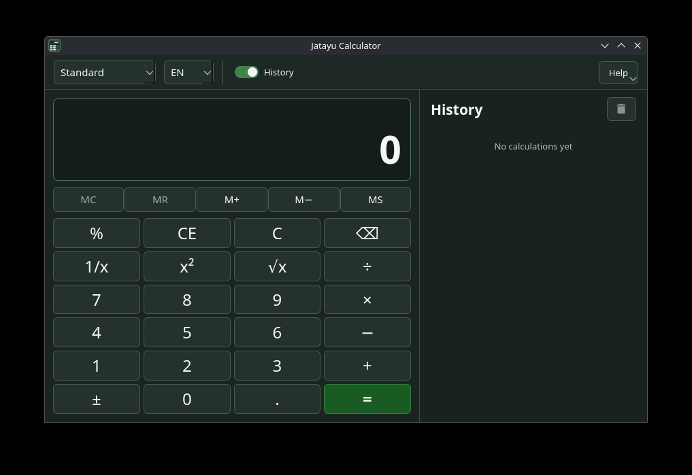

# Jatayu Calculator 1.1.1

A native C++ and Qt 6 Widgets calculator for JatayuOS and Debian 13. The approved reference is in [assets/approved-design.png](assets/approved-design.png). The mode menu offers Standard, Scientific, and Converter in the charcoal and forest-green theme.

## Install on JatayuOS

**[Download Jatayu Calculator v1.1.1 (.deb, amd64)](https://github.com/jatayuos4u/jatayu-calculator/releases/download/v1.1.1/jatayu-calculator_1.1.1-2_amd64.deb)**

[SHA-256 checksum](https://github.com/jatayuos4u/jatayu-calculator/releases/download/v1.1.1/SHA256SUMS) · [Release notes](https://github.com/jatayuos4u/jatayu-calculator/releases/tag/v1.1.1)

```sh
sudo apt install ./jatayu-calculator_1.1.1-2_amd64.deb
```

Open **Jatayu Calculator** from the application launcher. The language picker switches between English and Hindi. History is open by default and can be collapsed from the toolbar.

## Screenshot



## Use the calculator

- Enter an expression with the keypad or a keyboard. Use **Enter** or **=** to calculate, **Backspace** to remove a digit, **Delete** to clear the current entry, and **Esc** to clear the expression. **Ctrl+C** copies the result without grouping separators.
- Multiplication and division take priority over addition and subtraction. With addition and subtraction, percent applies to the expression so far. For example, `1500 + 10%` returns `1650`.
- Select a history row to edit that calculation. Right-click a row to copy its result. The app keeps the most recent 100 calculations locally and remembers the selected language and panel visibility.
- Memory works within the current session. **MS** stores the display, **MR** recalls it, **MC** clears it, and **M+** and **M−** add or subtract the displayed number.

## Scientific and Converter

- **Scientific** adds sine, cosine, tangent, base-10 and natural logarithms, powers, and the π and e constants. Select Deg or Rad for trigonometry. Enter the value before pressing a function. For powers, enter the base, press **xʸ** or type **^**, enter the exponent, and press **=**. Powers take precedence over multiplication and division and evaluate from right to left.
- **Converter** supports length, mass, temperature, speed, and data sizes. Select a category and units, then type a value to see the result. The swap button reverses the units and uses the converted value as the new input. Copy result copies the number without the unit.
- You can install this package over version 1.0.0. Existing history and language settings use the same local settings location.

## Help and credits

Open **Help** on the toolbar or press **F1** for the offline guide. The menu also shows the app version, creator, and dependency credits in English or Hindi. Jatayu Calculator is licensed under the [MIT License](LICENSE). See [third-party notices](packaging/THIRD-PARTY-NOTICES.txt) for Qt and Boost. The Boost license text is included in `packaging/BOOST-LICENSE.txt` and installed in the package's documentation directory. Qt is supplied by the system packages and their notices are in their respective documentation directories.

## Build on Debian 13

```sh
sudo apt install build-essential pkg-config qt6-base-dev libboost-dev
make
make test
./build/jatayu-calculator
make deb
```

The package is created in `build/`. To stage an installation for an ISO, use `make DESTDIR=/path/to/root PREFIX=/usr install`.

JatayuOS · Anup Kumar Yadav · https://jatayuos.in
